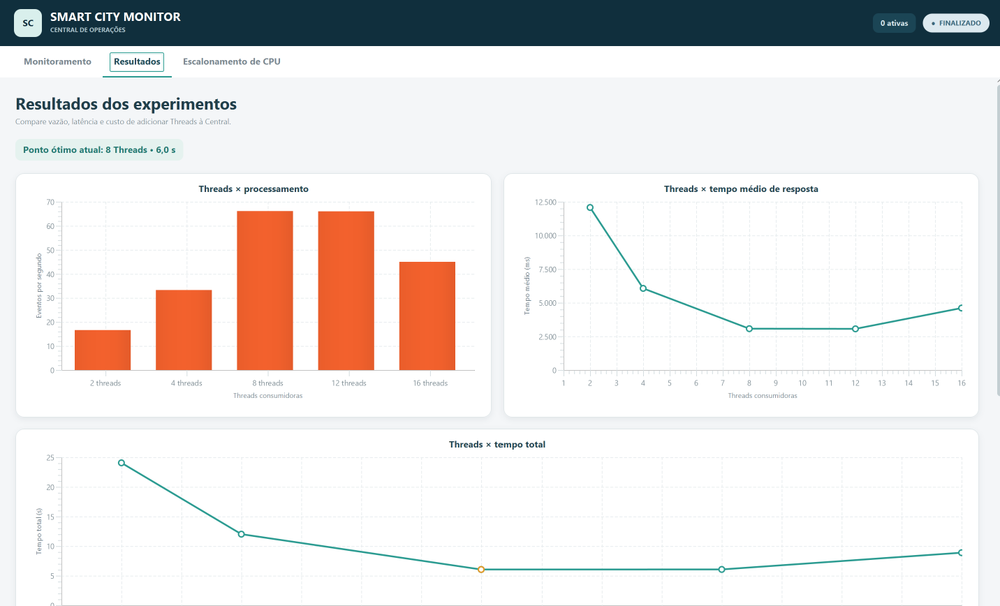

# Smart City Monitor

Sistema de monitoramento de uma cidade inteligente em Java/JavaFX, desenvolvido para a disciplina de
Sistemas Operacionais. O projeto tem **dois experimentos**:

1. **Monitoramento com Threads** — quantas Threads consumidoras a Central precisa para processar uma
   carga fixa de eventos? (abas *Monitoramento* e *Resultados*)
2. **Escalonamento de CPU e sincronismo** — como FCFS e Round Robin atendem os eventos da cidade e o
   que muda quando os processos escrevem num arquivo compartilhado **com e sem sincronismo**?
   (aba *Escalonamento de CPU*)

## Sumário

- [Como executar](#como-executar)
- [Experimento 1 — Monitoramento com Threads](#experimento-1--monitoramento-com-threads)
- [Experimento 2 — Escalonamento de CPU e sincronismo](#experimento-2--escalonamento-de-cpu-e-sincronismo)
  - [1. Modelo e escala dos valores](#1-modelo-e-escala-dos-valores)
  - [2. Algoritmos](#2-algoritmos)
  - [3. Métricas](#3-métricas)
  - [4. Sincronismo: a região crítica](#4-sincronismo-a-região-crítica)
  - [5. Guia da interface](#5-guia-da-interface)
  - [6. Cenários e resultados](#6-cenários-e-resultados)
  - [7. Por que o valor sem sincronismo às vezes é maior](#7-por-que-o-valor-sem-sincronismo-às-vezes-é-maior)
  - [8. Premissas e limitações](#8-premissas-e-limitações)
- [Testes](#testes)
- [Estrutura do projeto](#estrutura-do-projeto)
- [Tecnologias](#tecnologias)

---

## Como executar

Na pasta raiz do projeto (Java 17+ e Maven):

```bash
mvn clean javafx:run     # abre a aplicação
mvn clean test           # executa os testes
```

A aplicação tem três abas principais: **Monitoramento**, **Resultados** e **Escalonamento de CPU**.

---

## Experimento 1 — Monitoramento com Threads

### Objetivo

Avaliar como diferentes quantidades de Threads consumidoras influenciam o processamento de uma mesma
carga de eventos. A lista de eventos é fixa; o experimento altera principalmente a quantidade de
Threads da Central.

### Funcionamento

```text
Lista fixa de eventos → BlockingQueue → Central de Monitoramento → Threads consumidoras
        → Processamento concorrente → Métricas → Dashboard
```

Os eventos entram na fila antes do início do experimento; não há Threads de geração durante a
execução.

- De **1 a 16 Threads**, com tempo de processamento por evento configurável.
- Carga padrão de **400 eventos fixos**, distribuídos entre Trânsito, Clima, Energia e Qualidade do ar.
- O processamento usa carga real de CPU durante o tempo configurado. A partir de 8 Threads há um
  custo crescente de coordenação da Central, que permite identificar o ponto de melhor custo-benefício.

### Dashboard (aba *Monitoramento*)

Eventos gerados/processados/pendentes, vazão (eventos/s), tempo médio de resposta, tempo total,
gráfico de pendentes ao longo da execução, tabela dos eventos processados e representação 2D da
cidade (cada região é um tipo de evento; o evento concluído é animado até a Central).


### Resultados (aba *Resultados*)

Compara Threads × vazão, Threads × tempo médio de resposta e Threads × tempo total, e destaca o
**ponto ótimo atual** (menor tempo total entre os experimentos registrados).



---

## Experimento 2 — Escalonamento de CPU e sincronismo

Cada evento de sensor vira um **processo urbano** que precisa de tempo de CPU para ser analisado. O
simulador executa a **mesma carga** em dois escalonadores (FCFS e Round Robin) e, sobre cada um,
em dois modos de acesso ao arquivo compartilhado (**sem** e **com** sincronismo), para comparar como
cada combinação organiza e responde aos processos. A especificação completa está em
[`docs/SPEC-ESCALONAMENTO-CPU.md`](docs/SPEC-ESCALONAMENTO-CPU.md).

### 1. Modelo e escala dos valores

Todos os tempos estão em **unidades de tempo (ut)** abstratas. O resultado é **determinístico**: a
mesma carga e os mesmos parâmetros produzem exatamente o mesmo resultado a cada execução.

| Parâmetro | Significado | Padrão |
| --- | --- | ---: |
| Chegada | Instante em que o evento chega à Central | por processo |
| Burst | Tempo de CPU para analisar o evento (o "valor do sensor") | por processo |
| Quantum | Fatia máxima de CPU por vez (só Round Robin) | 10.000 ut |
| Troca de contexto | Custo de cada troca entre processos diferentes | 500 ut |
| Escrita no arquivo | Últimas *N* ut do burst, em que o processo grava seu registro | 15.000 ut |

**Escala dos testes.** Os valores didáticos clássicos (burst 8, 4 e 2 com quantum 2) escondem o efeito
do quantum. Por isso a carga padrão usa bursts de **dezenas de milhares** de ut:

| Processo | Evento | Chegada | Burst |
| --- | --- | ---: | ---: |
| P1 | Trânsito — Congestionamento detectado | 0 | 40.000 |
| P2 | Energia — Pico de consumo detectado | 5.000 | 20.000 |
| P3 | Qualidade do ar — Nível de poluentes elevado | 10.000 | 10.000 |

Os campos aceitam digitação direta (até 1.000.000 ut) e os botões **−/+** andam de 1.000 em 1.000
(100 no custo de troca). Valores pequenos continuam válidos. Para manter o Gantt legível, o simulador
recusa quantums que gerariam mais de **6.000 fatias** de CPU e avisa quanto seria o necessário.

### 2. Algoritmos

**FCFS (First-Come, First-Served)** — não preemptivo.
- Atende por ordem de chegada (empate: ordem de cadastro). Quem pega a CPU só a solta ao terminar.
- Entre dois processos diferentes consecutivos há uma troca de contexto de custo configurável.
- Se a CPU fica sem processo pronto, o intervalo aparece como **CPU ociosa** (sem troca de contexto).

**Round Robin** — preemptivo, com quantum.
- Fila de pronto FIFO. Cada processo usa `min(quantum, restante)` e, se não terminou, volta ao fim da fila.
- Processos que chegam durante uma fatia ou troca entram na fila **antes** do processo preemptado.
- Troca de contexto entre processos diferentes; se só resta um processo, ele continua sem troca.
- Com quantum **maior ou igual ao maior burst** (40.000 ut na carga padrão), o Round Robin nunca
  preempta e se comporta exatamente como o FCFS.

### 3. Métricas

| Métrica | Fórmula |
| --- | --- |
| Retorno | conclusão − chegada |
| Espera | retorno − burst (inclui o tempo bloqueado no lock, quando há) |
| Resposta | primeira execução − chegada |
| Duração total (*makespan*) | fim do último trecho do Gantt |
| Trocas de contexto | mudanças de processo entre trechos de CPU (e o tempo total gasto nelas) |
| CPU útil | soma dos bursts ÷ duração total |
| Vazão | processos concluídos ÷ duração total |

### 4. Sincronismo: a região crítica

Ao final do seu burst, cada processo **grava um registro** no arquivo compartilhado. Essa escrita é a
**região crítica** e ocupa as últimas *N* ut do burst (`min(burst, N)`). O registro tem o formato:

```text
INICIO|P2|ENERGIA|Pico de consumo detectado|FIM
```

A escrita é feita em fragmentos, na ordem em que a CPU executa cada unidade de escrita. Um registro
só é **íntegro** se a sua linha completa aparecer no arquivo.

**Sem sincronismo.** Nada impede que o Round Robin preempte um processo **no meio da escrita**. Se
outro processo escrever antes de ele terminar, os fragmentos se misturam (*condição de corrida*). No
cenário A (abaixo), o arquivo fica assim — `1 de 3` registros íntegros:

```text
INICIO|P2|ENERGIINICIO|P3|QUALIDADE_AR|Nível de poluentes elevado|FIM
A|Pico de consumo detectado|FIM
INICIO|P1|TRANSITO|Congestionamento detectado|FIM
```

**Com sincronismo** (lock, na prática um semáforo binário/mutex):
- O processo **pega o lock ao começar a escrever** e só o solta ao terminar (mesmo se for preemptado).
- Quem chega à região crítica com o lock ocupado **dorme**: não usa CPU, não gera troca de contexto
  e sai da fila de pronto.
- Quando o dono conclui, os bloqueados voltam ao fim da fila de pronto e tentam de novo.
- Resultado: o arquivo sempre fica íntegro (`3 de 3`), ao custo de espera.

```text
SEM lock                          COM lock
P2 ──escrevendo─╳ (preemptado)    P2 ──escrevendo─╳ (preemptado, segura o lock)
P3     escreve dentro da linha →  P3     chega, lock ocupado → DORME
        linhas misturadas                 P2 termina, libera → P3 escreve depois
```

**FCFS nunca colide**: sem preempção, ninguém interrompe uma escrita em andamento. Com e sem lock o
FCFS é idêntico.

### 5. Guia da interface

A aba **Escalonamento de CPU** tem uma **barra lateral** (recolhível em *☰ Carga e parâmetros*) e
três páginas:


**Barra lateral** — carga de processos (adicionar, editar ✎, remover ✕), menu **Cenários** (A e B, ver
abaixo) e parâmetros: quantum, troca de contexto e escrita no arquivo.

**Página 1 — Escalonamento de CPU.** Seletor `FCFS | Round Robin | Comparar os dois`.
- **Gantt em raias:** uma raia da CPU e uma por processo. A faixa clara é o tempo esperando na fila; o
  bloco sólido é o tempo na CPU; `TC` é troca de contexto.
- **Reprodução:** ▶ reproduz, *Passo* avança, ↺ reinicia, o controle desliza no tempo e a velocidade
  vai de 0,5× a 4×. Em cada instante o cartão mostra quem está na CPU e a fila de pronto.
- **Modo único:** cartões de métricas e tabela por processo. **Modo comparar:** os dois Gantts na
  mesma escala, placar com barras pareadas, leitura rápida e o gráfico *Efeito do quantum*.


**Página 2 — Sincronismo × escalonamento.** Seletor `FCFS | Round Robin | Comparar os dois`. Cada
escalonador roda **duas vezes** (sem e com lock) sobre a mesma carga e os mesmos parâmetros.
- O Gantt mostra a **escrita** (hachurada), o **bloqueio** no lock (vermelho, "esperando lock") e
  uma linha fina sob a raia do processo: cinza = janela de escrita, **vermelha = registro corrompido**.
- Cada cartão mostra quem está na CPU, a fila, os **bloqueados**, o estado do arquivo (`lock com P2`,
  `⚠ colisão: P2 + P3 escrevendo ao mesmo tempo`) e os registros ✓/✕.
- No modo *Comparar os dois* os quatro cenários ficam numa grade 2×2 na mesma escala de tempo, com
  placar de quatro barras por métrica e leitura rápida em texto.


**Página 3 — Prova com threads reais.** Mantém o experimento original: uma Thread de sensor por
processo escrevendo de verdade num arquivo físico, sem e com `ReentrantLock`. Mostra o conteúdo do
arquivo linha a linha (✓/✕). A duração é a **mediana de 15 execuções** após aquecimento. Serve como
**prova de integridade**; não use essa página para comparar desempenho (ver [seção 7](#7-por-que-o-valor-sem-sincronismo-às-vezes-é-maior)).


### 6. Cenários e resultados

Os dois cenários abaixo estão no menu **Cenários** da barra lateral e nos testes automatizados.

#### Cenário A — Colisão no Round Robin (carga padrão)

Quantum 10.000 · troca 500 · escrita 15.000 · P1 0/40.000 · P2 5.000/20.000 · P3 10.000/10.000.

| Escalonador | Lock | Registros íntegros | Espera | Resposta | Retorno | Duração | Trocas (ut) | Bloqueado | CPU útil |
| --- | --- | ---: | ---: | ---: | ---: | ---: | ---: | ---: | ---: |
| FCFS | sem | 3 de 3 | 28.833,33 | 28.833,33 | 52.166,67 | 71.000 | 2 (1.000) | 0 | 98,59% |
| FCFS | com | 3 de 3 | 28.833,33 | 28.833,33 | 52.166,67 | 71.000 | 2 (1.000) | 0 | 98,59% |
| Round Robin | sem | **1 de 3** | 23.500,00 | 5.500,00 | 46.833,33 | 72.500 | 5 (2.500) | 0 | 96,55% |
| Round Robin | com | 3 de 3 | 30.333,33 | 19.333,33 | 53.666,67 | 72.500 | 5 (2.500) | 31.000 | 96,55% |

Round Robin sem lock (milhares de ut): `P1 0–10 | TC | P2 10,5–20,5 | TC | P3 21–31 | TC | P1 31,5–41,5 |
TC | P2 42–52 | TC | P1 52,5–72,5`.

- **O que acontece sem lock:** o P2 começa a escrever em 15.500 e é preemptado em 20.500 com o
  registro aberto. O P3 (cuja escrita ocupa o burst inteiro) escreve de 21.000 a 31.000, dentro da
  linha do P2: os dois registros se perdem. O P1 só escreve no fim, sozinho (íntegro).
- **O que acontece com lock:** o P2 segura o lock; o P3 dorme de 20.500 a 41.500 e de 52.000 a
  62.000 (31.000 ut somados) e é o último a terminar.
- **Leitura:** nenhum algoritmo vence em tudo. O FCFS é o melhor em duração, trocas e CPU útil e não
  precisa de lock. O Round Robin responde bem mais cedo (resposta 5.500 contra 28.833) e tem menor
  espera sem lock, mas **só é íntegro com lock**, e então a espera passa a ser maior que a do FCFS.

#### Cenário B — O lock melhora os tempos

Quantum 4.000 · troca 1.000 · escrita 6.000 · P1 0/10.000 · P2 4.000/10.000 · P3 4.000/10.000.

| Escalonador | Lock | Registros íntegros | Espera | Resposta | Retorno | Duração | Trocas (ut) | Bloqueado | CPU útil |
| --- | --- | ---: | ---: | ---: | ---: | ---: | ---: | ---: | ---: |
| FCFS | sem | 3 de 3 | 8.333,33 | 8.333,33 | 18.333,33 | 32.000 | 2 (2.000) | 0 | 93,75% |
| FCFS | com | 3 de 3 | 8.333,33 | 8.333,33 | 18.333,33 | 32.000 | 2 (2.000) | 0 | 93,75% |
| Round Robin | sem | **0 de 3** | 22.333,33 | 2.333,33 | 32.333,33 | 38.000 | 8 (8.000) | 0 | 78,95% |
| Round Robin | com | 3 de 3 | **15.333,33** | 2.333,33 | **25.333,33** | **35.000** | **5 (5.000)** | 6.000 | 85,71% |

Aqui o valor **sem** sincronismo é **maior** que o valor **com** sincronismo em espera, retorno,
duração e trocas. Isso é esperado e está explicado na [seção 7](#7-por-que-o-valor-sem-sincronismo-às-vezes-é-maior).

#### Efeito do quantum (Round Robin, cenário A com troca 500 e escrita 15.000)

| Quantum | Íntegros (sem) | Espera sem lock | Espera com lock | Trocas sem | Trocas com | Bloqueado (com) |
| ---: | :---: | ---: | ---: | ---: | ---: | ---: |
| 2.500 | 1 de 3 | 33.666,67 | **31.166,67** | 20 | 19 | 20.000 |
| 5.000 | 1 de 3 | 27.500,00 | **27.333,33** | 10 | 10 | 16.000 |
| 10.000 | 1 de 3 | **23.500,00** | 30.333,33 | 5 | 5 | 31.000 |
| 15.000 | 0 de 3 | **30.166,67** | 30.333,33 | 5 | 5 | 21.500 |
| 20.000 | 3 de 3 | 26.000,00 | 26.000,00 | 3 | 3 | 0 |
| 40.000 | 3 de 3 | 28.833,33 | 28.833,33 | 2 | 2 | 0 |

- Quantum **pequeno**: muitas trocas; o lock elimina algumas e até reduz a espera.
- Quantum **médio**: preempção cortando escritas e lock com bloqueios longos (o pior caso do lock).
- Quantum **≥ 20.000**: nenhuma escrita é cortada, então não há colisão nem disputa.
- Quantum **≥ 40.000**: o Round Robin vira FCFS (2 trocas, duração 71.000).

#### Efeito do tamanho da escrita (Round Robin, quantum 10.000)

| Escrita | Íntegros sem lock | Espera sem lock | Espera com lock | Bloqueado (com) |
| ---: | :---: | ---: | ---: | ---: |
| 1.000 – 10.000 | 3 de 3 | 23.500,00 | 23.500,00 | 0 |
| 15.000 | 1 de 3 | 23.500,00 | 30.333,33 | 31.000 |
| 40.000 | 0 de 3 | 23.500,00 | 28.833,33 | 70.000 |

Escritas curtas (que cabem em uma fatia) não colidem. Quanto mais longa a região crítica, maior a
chance de a preempção cortá-la e maior o tempo de bloqueio com lock.

### 7. Por que o valor sem sincronismo às vezes é maior

> Explicação completa, passo a passo, em
> [`docs/POR-QUE-SEM-LOCK-PODE-SER-MAIOR.md`](docs/POR-QUE-SEM-LOCK-PODE-SER-MAIOR.md).

**Na simulação (tempo lógico) isso acontece de verdade e é esperado.** O lock não só protege o
arquivo: ele muda o escalonamento. Processos bloqueados não são despachados, então há **menos trocas
de contexto** (cada uma custa CPU sem trabalho útil) e o dono do lock **termina sem ser
interrompido**, deixando o Round Robin mais próximo de "rodar até acabar". No cenário B isso reduz as
trocas de 8 para 5 e a espera média de 22.333 para 15.333.

Em uma amostra de 20.000 cargas aleatórias do Round Robin, o lock **reduziu a espera média em 41,6%**
das cargas, igualou em 47,4% e **aumentou em 11,0%**; reduziu as trocas de contexto em 35,7%. Ele
costuma **piorar o tempo de resposta** (30,4% das cargas), porque o processo bloqueado demora mais
para ser atendido. O FCFS nunca muda. O teste
`amostraAleatoriaMostraQueOLockPodeMelhorarOuPiorarOsTempos` reproduz essa amostra.

**Nas threads reais (milissegundos) era ruído de medição.** A primeira execução da JVM é lenta
(carga de classes, JIT, criação do arquivo) e penalizava quem rodava primeiro. Agora há aquecimento,
mediana de 15 execuções e modos alternados. Mesmo assim, em ms de relógio o resultado pode oscilar:
o modo sem lock usa uma barreira (`CyclicBarrier`) para forçar a colisão e as threads dormem 1 ms
entre fragmentos, então a duração dele inclui essa espera. A página de threads reais prova a
**integridade** do arquivo; o desempenho deve ser lido na página *Sincronismo × escalonamento*.

### 8. Premissas e limitações

- O sincronismo é simulado com **um único lock** sobre **um único arquivo**; como só há um lock, não
  há *deadlock*. Ao liberar, os bloqueados voltam à fila de pronto e **tentam de novo** (não há
  entrega direta do lock em ordem FIFO).
- A região crítica fica sempre **no final do burst** e tem o mesmo tamanho (*N*) para todos os
  processos (limitado ao burst do processo).
- A tentativa de pegar o lock não consome tempo de CPU; só dorme quem encontra o lock ocupado.
- Não há prioridades nem tempo real: um evento crítico (por exemplo, queda de energia) esperaria como
  qualquer outro. Prioridades seriam a extensão natural.
- As unidades de tempo são abstratas; para mapear em milissegundos basta definir 1 ut = 1 ms (a carga
  padrão corresponde a eventos de 10 a 40 s).

---

## Testes

```bash
mvn clean test
```

| Área | O que é verificado |
| --- | --- |
| Monitoramento | Processamento sem perdas ou duplicações com 1 a 16 Threads, encerramento das Threads, fluxo do dashboard |
| `Fcfs`, `RoundRobin`, `CalculadoraMetricas` | Cargas de referência com valores pequenos **e** com bursts de 40.000 ut / quantum 10.000, ociosidade, desempate, parâmetros inválidos |
| `EscalonamentoGrandeEscalaTest` | Valores de dezenas de milhares e até 1.000.000 ut; Round Robin vira FCFS com quantum ≥ maior burst; efeito do quantum |
| `SimuladorEscalonamentoSincronizadoTest` | Cenários A e B com números exatos; sem lock reproduz o Gantt de FCFS/RR; com lock nunca corrompe; FCFS não muda; escalonamento invariante à escala (×1, ×1.000, ×5.000); 300 cargas aleatórias grandes; amostra de 20.000 cargas (lock melhora/piora) |
| `SimuladorSincronismoTest` | Threads reais: colisão sem lock, arquivo íntegro com lock, mediana e aquecimento |
| `EscalonamentoControllerTest` | Carga padrão, cenários, limites (1.000.000 ut), recusa de quantum que geraria fatias demais |

---

## Estrutura do projeto

```text
src/
├── main/
│   ├── java/br/smartcity/monitor/
│   │   ├── central/                 # Central e Threads consumidoras
│   │   ├── config/
│   │   ├── metrics/
│   │   ├── model/
│   │   ├── sensor/
│   │   ├── ui/                      # Dashboard e aplicação
│   │   └── escalonamento/
│   │       ├── model/               # ProcessoUrbano, trechos do Gantt, métricas
│   │       ├── algoritmo/           # Fcfs, RoundRobin
│   │       ├── simulacao/           # CalculadoraMetricas, ComparacaoEscalonamento
│   │       ├── sincronismo/         # Simulador integrado (lock) e experimento com threads reais
│   │       └── ui/                  # EscalonamentoView, páginas, Gantt, controller, cenários
│   └── resources/br/smartcity/monitor/
│       ├── ui/
│       └── escalonamento/ui/        # escalonamento.css
└── test/java/br/smartcity/monitor/
docs/
├── SPEC-ESCALONAMENTO-CPU.md
├── POR-QUE-SEM-LOCK-PODE-SER-MAIOR.md
└── img/                             # prints usados neste README
```

## Tecnologias

Java 17+ · JavaFX · Maven · JUnit 5 · `BlockingQueue` · `AtomicInteger`/`AtomicLong` ·
`ReentrantLock` · `CyclicBarrier` · Threads e concorrência
